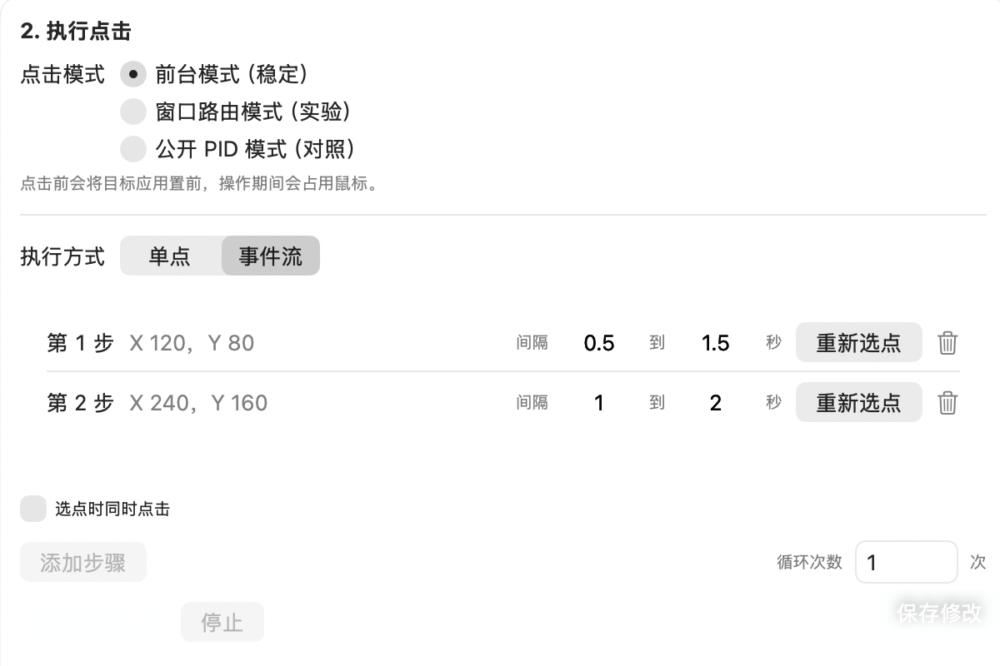

# Current

<p align="center">
  
  <br>
  原生 macOS 窗口自动点击工具
  <br>
  保存点击任务，按顺序编排事件流，让重复操作更简单。
  <br>
  macOS 14+ · SwiftUI · 本地保存 · 无需目标应用提供脚本接口
</p>

## 功能特性

| 功能 | 说明 |
| --- | --- |
| 多任务管理 | 新增、删除和切换任务；配置保存在本机，重启后自动恢复 |
| 单击与连点 | 十字准星选点，自定义连点间隔和次数，随时停止 |
| 事件流 | 多个位置按顺序执行，支持有限轮次循环 |
| 随机等待 | 每步在最小与最大间隔之间随机取值，精确到 0.1 秒 |
| 边选边点 | 可选“选点时同时点击”，边操作边编排步骤 |
| 紧急停止 | 连点或事件流运行中按 `Control + Option + Esc` 停止 |

## 使用步骤

### 1. 创建并保存任务

点击左侧“新增”会立即创建并选中任务。修改名称或配置后，点击右下角悬浮按钮保存。


### 2. 选择窗口与点击位置

1. 在“选择窗口”中选中目标窗口。
2. 单点模式点击“选取位置”；事件流模式点击“添加步骤”。
3. 在目标窗口中移动十字准星并双击，记录相对窗口左上角的坐标。
4. 如需边操作边编排，开启“选点时同时点击”。

### 3. 编排事件流

每一步都可以重新选点、删除，并设置随机等待范围。最后一轮的最后一次点击后不再等待。


### 4. 运行与停止

选择“单击一次”“开始连点”或“开始事件流”。连点与事件流运行期间，可随时按 `Control + Option + Esc` 紧急停止。

## 点击模式

| 模式 | 适用场景 | 注意事项 |
| --- | --- | --- |
| 前台模式（默认） | 兼容性最好，适合大多数应用 | 点击前将目标应用置前，操作期间占用鼠标 |
| 窗口路由模式 | 希望不切换窗口、不占用鼠标 | 实验性；优先 AXPress，无可用控件时回退合成点击 |
| 公开 PID 模式 | 公开 API 对照测试 | 多数应用不会响应 |

## 构建与运行

### 环境要求

- macOS 14 或更高版本
- Xcode 15 或更高版本
- [XcodeGen](https://github.com/yonaskolb/XcodeGen)

### 本地构建

```bash
cp project.local.yml.example project.local.yml
```

在 `project.local.yml` 中填入自己的 Apple Development 签名信息，然后执行：

```bash
xcodegen generate
xcodebuild -quiet test \
  -project Current.xcodeproj \
  -scheme Current \
  -destination 'platform=macOS' \
  -derivedDataPath build/DerivedData
open build/DerivedData/Build/Products/Debug/Current.app
```

首次运行需要在“系统设置 → 隐私与安全性 → 辅助功能”中授权 Current。若更换 Bundle ID 或签名身份，可能需要重新授权。

## 工作原理

1. **AXPress 优先**：在窗口路由模式下，通过 Accessibility 树定位目标控件并直接按下，不移动真实鼠标，也不产生鼠标事件。
2. **窗口路由回退**：坐标处没有可按控件时，通过窗口路由投递合成点击。
3. **窗口顺序恢复**：若点击导致目标窗口被抬前，尝试恢复原有窗口层级和前台应用。

## 数据与隐私

任务配置仅保存到本机 Application Support 目录，不需要账号，也不会上传配置。目标窗口 ID 和进程 ID 不会作为永久标识保存。

## 已知限制

- 最小化、锁屏后或不在当前桌面的窗口无法正常点击。
- 自绘界面和部分游戏没有可用的 AX 控件，只能使用合成点击。
- 窗口路由依赖非公开系统行为，macOS 升级后需要重新验证。
- 不提供无限循环；事件流轮数必须是正整数。

## 主要目录结构

```text
Sources/
  AppModel.swift               界面状态、任务操作与点击调度
  ContentView.swift            主界面
  FlowConfiguration.swift      事件流模型与校验
  TaskConfiguration.swift      任务快照与窗口匹配
  TaskStore.swift              本地 JSON 持久化
  PickerController.swift       十字准星选点面板
  AXWindowClicker.swift        AX 定位与 AXPress
  WindowRoutedClickDriver.swift 窗口路由合成点击
  ForegroundClickDriver.swift  前台全局事件
Tests/                       配置、持久化与坐标测试
Resources/                   Logo 与应用图标
Documentation/               README 界面截图
```

## 参考

- [NSExceptional/winctl](https://github.com/NSExceptional/winctl)：窗口路由消融实验
- [trycua/cua](https://github.com/trycua/cua)：后台点击与焦点保护实现
- [koekeishiya/yabai](https://github.com/koekeishiya/yabai)：窗口焦点管理方案

## 开源协议

Current 基于 [MIT License](LICENSE) 开源，允许自由使用、修改和分发，但需保留原始版权与许可声明。
